<picture>
  <source media="(prefers-color-scheme: dark)" srcset="assets/card-dark.svg">
  
</picture>

<picture>
  <source media="(prefers-color-scheme: dark)" srcset="assets/stats-dark.svg">
  
</picture>

**Recent fixes**

- [AIBrix #3054](https://github.com/vllm-project/aibrix/pull/3054): v0.7.0 batch jobs survive the v0.8.0 upgrade
- [AIBrix #3080](https://github.com/vllm-project/aibrix/pull/3080): gateway tracing off by default again
- [GPUStack #6394](https://github.com/gpustack/gpustack/pull/6394): MindIE honours `NPU_MEMORY_FRACTION`
- [SQLFluff #8710](https://github.com/sqlfluff/sqlfluff/pull/8710): ST09 keeps the null-safe `<=>`
- [REA #2333](https://github.com/morluto/rea/pull/2333): `--filter-output` keeps a selected JSON `null`

**Projects**: [ib_strategy_project](https://github.com/Jackmeson1/ib_strategy_project) ·
[ocrdlp-lab](https://github.com/Jackmeson1/ocrdlp-lab)
