<picture>
  <source media="(prefers-color-scheme: dark)" srcset="assets/card-dark.svg">
  
</picture>

<picture>
  <source media="(prefers-color-scheme: dark)" srcset="assets/flow-dark.svg">
  
</picture>

<a href="https://github.com/search?q=author%3AJackmeson1+is%3Apr+is%3Amerged+repo%3Agpustack%2Fgpustack+repo%3Alballabio%2FQuantLib+repo%3Amorluto%2Frea+repo%3Asqlfluff%2Fsqlfluff+repo%3Avladmandic%2Fsdnext+repo%3Avllm-project%2Faibrix+repo%3Avllm-project%2Fguidellm+repo%3Avllm-project%2Fsemantic-router+repo%3Axorbitsai%2Finference&type=pullrequests&s=created&o=desc">
<picture>
  <source media="(prefers-color-scheme: dark)" srcset="assets/merged-dark.svg">
  
</picture>
</a>
